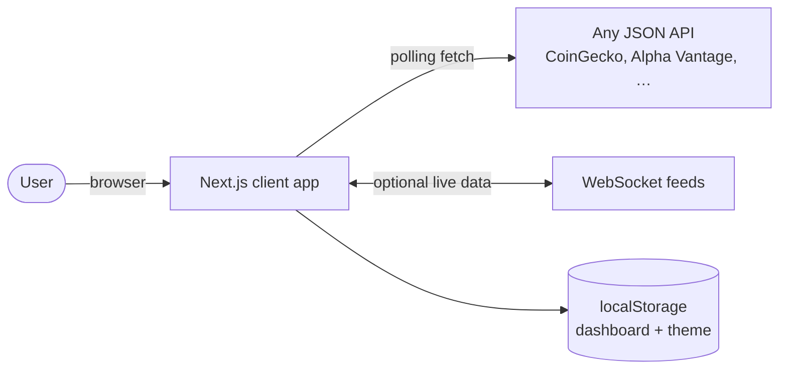

# FinBoard (Finance Dashboard Builder): High-Level Design

A no-code finance dashboard builder: connect any JSON API, pick the fields to show, display them as cards, tables or charts, auto-refresh or stream them over WebSocket, drag to rearrange, and save, export or start from templates. Live at [v0-finance-dashboard-builder-chi.vercel.app](https://v0-finance-dashboard-builder-chi.vercel.app). For code-level detail see the [Low-Level Design](lld.md).

## 1. Context

Everything runs in the browser; there is no backend. The dashboard is persisted locally and can be exported or imported as JSON.

## 2. Components

| Component | Responsibility |
|---|---|
| Dashboard header | Add widget, templates, export / import, theme toggle |
| Add widget modal | API URL, test connection, field picker, display mode, refresh interval, optional WebSocket URL |
| Dashboard grid | Sortable widgets (drag and drop), polling and WebSocket subscriptions |
| Widgets | `card-widget`, `table-widget`, `chart-widget` (line chart) inside `widget-card` |
| Template gallery | Crypto tracker, stock monitor, forex, economic calendar, portfolio tracker |
| Stores | Zustand `dashboard-store` and `theme-store`, both persisted |

## 3. Tech

| Layer | Choice |
|---|---|
| Framework | Next.js (App Router) + TypeScript |
| State | Zustand with `persist` |
| UI | Tailwind CSS, shadcn/ui (Radix) |
| Drag and drop | dnd-kit |
| Charts | Recharts |
