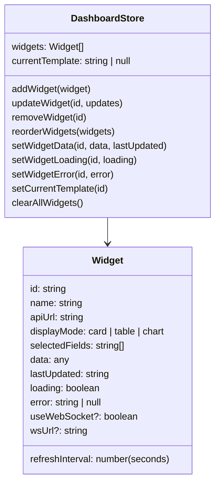
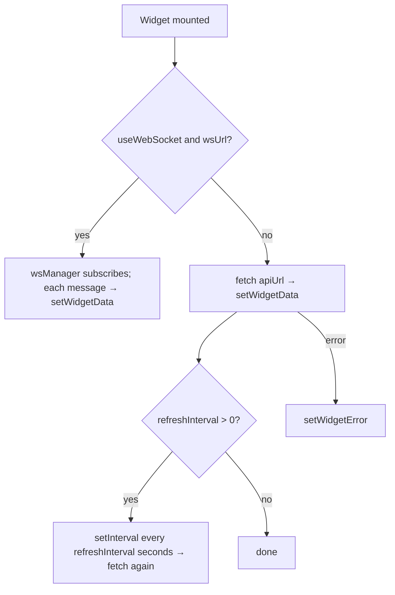

# FinBoard (Finance Dashboard Builder): Low-Level Design

For the big picture see the [High-Level Design](hld.md).

## 1. Widget model and store

The store is persisted under `finboard-dashboard`; export / import uses `finboard-config` (`lib/storage.ts`).

## 2. Data updates

## 3. Field handling (`lib/api-utils.ts`)

| Function | Behavior |
|---|---|
| `testApiConnection(url)` | Fetches the URL once to validate it before saving the widget |
| `flattenObject(obj)` | Turns nested JSON into dot-path keys so any field can be picked |
| `extractFields(data)` | Lists selectable paths |
| `getNestedValue(obj, path)` | Reads a dot-path value for display |

## 4. Reordering

The grid uses dnd-kit `SortableContext` with a vertical strategy and keyboard support; on drop, `arrayMove` produces the new order and `reorderWidgets` saves it.

## 5. Templates (`lib/dashboard-templates.ts`)

| Template id | Purpose |
|---|---|
| `crypto-tracker` | Bitcoin and Ethereum prices, exchange rates |
| `stock-monitor` | Market movers and major assets |
| `forex-dashboard` | Currency rates |
| `economic-calendar` | Macro indicators |
| `portfolio-tracker` | Holdings overview |
